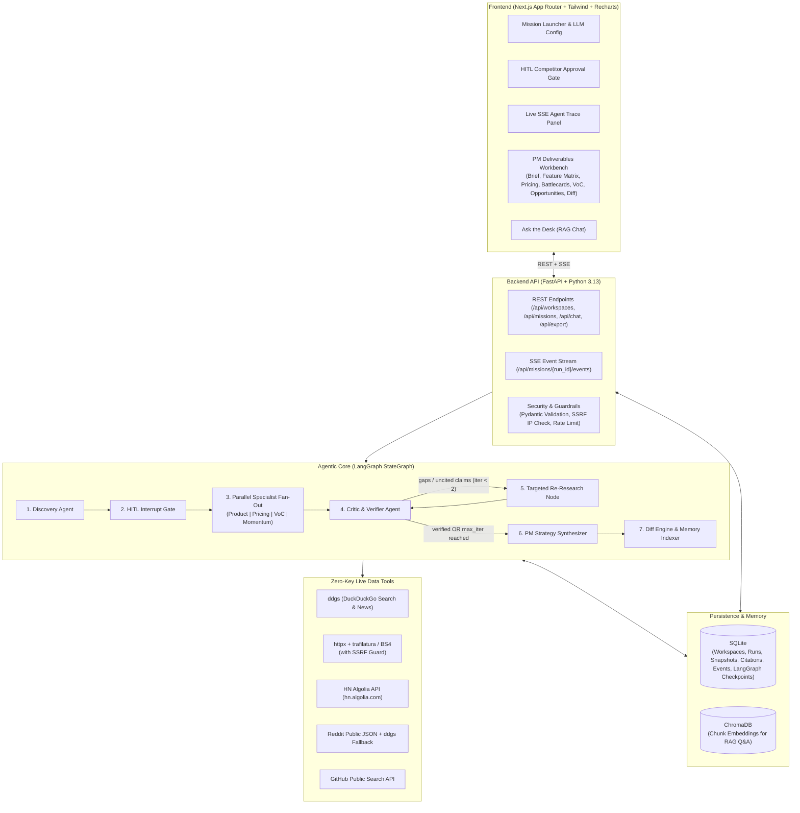

# Architecture: Competitive Market Intelligence Desk (CMI Desk)

## 1. High-Level System Architecture



---

## 2. LangGraph State & Execution Flow

### Graph State (`IntelligenceState`)
- `run_id: str`, `workspace_id: str`
- `product_name: str`, `product_description: str`, `target_segment: str`, `seed_competitors: list[str]`
- `llm_provider: str`, `llm_model: str`
- `discovered_competitors: list[CompetitorCandidate]`
- `approved_competitors: list[CompetitorCandidate]`
- `research_findings: Annotated[list[DomainFinding], operator.add]` (parallel fan-in reducer)
- `citations: Annotated[list[SourceCitationInput], operator.add]`
- `critic_report: CriticReport | None`
- `research_gaps: list[ResearchGap]`
- `iteration_count: int` (bounded: max 2 verification retries)
- `dossier: DossierPayload | None`
- `diff_summary: DiffSummary | None`

### Key Agentic Patterns Demonstrated
1. **Multi-Provider LLM Abstraction (`llm_factory.py`)**: Dynamically instantiates LangChain chat models for `gemini` (`langchain-google-genai`), `openai` (`langchain-openai`), `anthropic` (`langchain-anthropic`), or `groq` (`langchain-groq`) using server `.env` keys (plus optional explicit provider availability endpoint `/api/providers` that never leaks raw secrets).
2. **Human-in-the-Loop Checkpointing**: `discovery_node` populates `discovered_competitors` and hits `interrupt(...)` backed by `SqliteSaver`. The mission enters `awaiting_approval`. When the PM submits edits via `POST /api/missions/{run_id}/approve`, the graph resumes via `Command(resume=...)`.
3. **Parallel Specialist Fan-Out (`Send`)**: For each approved competitor (plus category-wide market research), specialist sub-tasks collect live evidence concurrently using bounded async concurrency (`asyncio.Semaphore`).
4. **Critic / Reflection Loop**: `critic_verifier_node` validates every factual claim against retrieved URLs/snippets, checks matrix/pricing/VoC completeness, computes a `grounding_score`, and routes to `targeted_research_node` if critical gaps remain (`iteration_count < 2`).
5. **Longitudinal Snapshot Diffing & RAG**: `memory_indexer_node` compares the new `DossierSnapshot` with the previous snapshot for the same `workspace_id` and stores structured diff highlights plus vector chunks in ChromaDB.

---

## 3. Repository Layout

```text
COMPETITIVE MARKET INTELLIGENCE DESK/
├── PRD.md
├── ARCHITECTURE.md
├── TASKS.md
├── .env.example
├── backend/
│   ├── pyproject.toml
│   ├── app/
│   │   ├── main.py                 # FastAPI entrypoint, lifespan, CORS
│   │   ├── config.py               # Settings & env key detection
│   │   ├── db/
│   │   │   ├── database.py         # SQLite schema & repository helpers
│   │   │   └── vector_store.py     # ChromaDB indexing & semantic retrieval
│   │   ├── schemas/
│   │   │   └── intelligence.py     # Strict Pydantic v2 contracts
│   │   ├── llm/
│   │   │   └── factory.py          # Multi-provider LLM factory
│   │   ├── tools/
│   │   │   ├── security.py         # SSRF / private IP / URL sanitizer
│   │   │   ├── web_search.py       # ddgs search wrapper
│   │   │   ├── web_scraper.py      # httpx + trafilatura/BS4 extractor
│   │   │   ├── community.py        # HN Algolia, Reddit JSON, GitHub API
│   │   │   └── registry.py         # Unified async collector + citation builder
│   │   ├── agents/
│   │   │   ├── state.py            # LangGraph TypedDict state
│   │   │   ├── nodes.py            # Discovery, Specialists, Critic, Synthesizer, Memory
│   │   │   ├── graph.py            # Compiled StateGraph + SqliteSaver
│   │   │   ├── diff_engine.py      # Snapshot-to-snapshot diff computation
│   │   │   └── rag_chat.py         # Citation-grounded follow-up analyst
│   │   ├── services/
│   │   │   ├── mission_runner.py   # Background async runner + SSE event pub/sub
│   │   │   └── exporter.py         # Markdown & JSON dossier exporter
│   │   └── api/
│   │       └── routes.py           # REST + SSE API endpoints
│   ├── tests/
│   │   ├── test_security.py
│   │   ├── test_tools.py
│   │   ├── test_diff_and_exporter.py
│   │   ├── test_graph_critic.py
│   │   ├── test_vector_and_rag.py
│   │   └── test_api.py
│   └── eval/
│       └── run_eval.py             # Grounding, Completeness, & Critic Eval Harness
└── frontend/
    ├── package.json
    ├── src/
    │   ├── app/
    │   │   ├── layout.tsx
    │   │   ├── page.tsx            # Main Intelligence Desk workbench
    │   │   └── globals.css
    │   ├── lib/
    │   │   ├── types.ts            # TypeScript contracts mirroring backend schemas
    │   │   └── api.ts              # Typed API + SSE client
    │   └── components/
    │       ├── SidebarWorkspaces.tsx
    │       ├── MissionLauncher.tsx
    │       ├── HitlApprovalModal.tsx
    │       ├── AgentTracePanel.tsx
    │       ├── DossierTabs.tsx
    │       ├── OpportunityChart.tsx
    │       └── RagChatPanel.tsx
```

---

## 4. API Contracts

| Method | Path | Purpose |
|---|---|---|
| `GET` | `/api/health` | Health check + DB readiness |
| `GET` | `/api/providers` | Lists configured LLM providers/models from `.env` (no secrets returned) |
| `GET` | `/api/workspaces` | List saved PM workspaces & latest snapshot summary |
| `POST` | `/api/workspaces` | Create a new workspace |
| `GET` | `/api/workspaces/{workspace_id}/snapshots` | List historical snapshots & latest dossier |
| `POST` | `/api/missions` | Start a new LangGraph mission run (`run_id`, `thread_id`) |
| `GET` | `/api/missions/{run_id}` | Fetch current run status, discovered competitors, and dossier |
| `GET` | `/api/missions/{run_id}/events` | SSE stream of live `AgentEvent` updates + HITL interrupt signal |
| `POST` | `/api/missions/{run_id}/approve` | Submit PM-edited competitor list & resume LangGraph from HITL |
| `POST` | `/api/workspaces/{workspace_id}/chat` | Ask the Desk (RAG Q&A grounded in ChromaDB + SQLite citations) |
| `GET` | `/api/missions/{run_id}/export` | Export dossier (`format=markdown` or `format=json`) |

---

## 5. Security & Reliability Guardrails

- **SSRF Protection:** Every scraped URL is parsed and resolved before `httpx` requests; private, loopback, link-local, multicast, and reserved IPs (`127.0.0.0/8`, `10.0.0.0/8`, `169.254.0.0/16`, `::1`, etc.) and non-`http(s)` schemes are blocked.
- **Prompt Injection Mitigation:** Web snippets are wrapped in clear data delimiters (`<source_evidence>...</source_evidence>`) and treated as untrusted text; LLM outputs are validated against strict Pydantic v2 schemas.
- **Bounded Loops & Timeouts:** Tool HTTP calls use strict connect/read timeouts (`10s`), payload size limits, and bounded critic retries (`max_iterations = 2`) to prevent infinite loops or runaway token bills.
- **No Secret Leakage:** `.env` keys remain strictly backend-side; `/api/providers` returns only boolean availability and supported model names.
