# MoatRadar

[](https://github.com/Vinay7766/moatradar/actions/workflows/ci.yml)
[](./LICENSE)
[](https://www.python.org/)
[](https://nextjs.org/)

**Open-source, self-hosted Multi-Agent Competitive Market Intelligence Platform for Product Managers.**

MoatRadar turns live, zero-key web, pricing, Hacker News, Reddit, and GitHub signals into verified PM deliverables—using **LangGraph**, **human-in-the-loop (HITL)** competitor gating, a **Critic verification loop**, **snapshot diffing**, and **ChromaDB RAG chat**—with full support for local **Ollama** models as well as Gemini, OpenAI, Anthropic, and Groq.

---

## Core Capabilities

- **Zero Hardcoded Defaults & Live Model Verification**:
  - **Ollama (Local / Zero-Key)**: Enter any installed Ollama model tag (e.g., `gemma4:12b`) and verify local availability via `POST /api/providers/ollama/check` before running.
  - **Cloud Providers**: Configure `GEMINI_API_KEY`, `OPENAI_API_KEY`, `ANTHROPIC_API_KEY`, or `GROQ_API_KEY` in `.env`; models are queried dynamically without static fallback lists.
- **Human-in-the-Loop (HITL) Discovery Gate**:
  - Discovers 3–6 direct and adjacent competitors, then pauses execution via LangGraph `interrupt()` backed by SQLite checkpointing so you can add, remove, or edit targets before deep research begins.
- **Parallel Multi-Domain Specialists + Critic Reflection Loop**:
  - Collects live evidence across web search (`ddgs`), scraped primary pages (`httpx` + `trafilatura`/`BeautifulSoup4` with SSRF IP validation), HN Algolia, Reddit JSON, and GitHub Search API.
  - Audits extracted claims against cited URLs/snippets in a bounded reflection loop (`max_critic_iterations = 2`).
- **Complete PM Deliverable Suite**:
  - **Executive Brief & Trends**, **Feature Comparison Matrix**, **Pricing & Packaging Matrix**, **Competitor SWOT & Battlecards**, **Voice-of-Customer (VoC) Sentiment**, and **White-Space Opportunity Matrix** (Impact vs. Effort Recharts plot).
  - Export full dossiers as **Markdown**, **JSON**, or **Print/PDF**.
- **Longitudinal Diffing & Ask-the-Desk RAG Chat**:
  - Re-running a saved workspace diffs the new dossier against the prior snapshot and indexes chunks into **ChromaDB** for citation-grounded Q&A.

---

## Architecture

```mermaid
flowchart LR
    UI["Next.js Workbench\n(SSE Trace + HITL + Dossiers + RAG)"] <-->|REST + SSE| API["FastAPI API\n(SSRF Guard + Pydantic v2)"]
    API --> Disc["Discovery Agent"]
    Disc --> HITL["HITL Interrupt Gate\n(SQLite Checkpointer)"]
    HITL --> Spec["Parallel Collectors\n(ddgs · Scraper · HN · Reddit · GitHub)"]
    Spec --> Critic["Critic Verifier"]
    Critic -->|Gaps found| Spec
    Critic -->|Verified| Synth["PM Synthesizer"]
    Synth --> Mem["Snapshot Diff Engine\n+ ChromaDB Indexer"]
```



For full state definitions, API contracts, and security controls, see [docs/architecture.md](./docs/architecture.md), [docs/prd.md](./docs/prd.md), and [docs/roadmap.md](./docs/roadmap.md).

---

## Quick Start

### Option 1: Docker Compose (Recommended for Self-Hosting)

1. Copy `.env.example` to `.env` (no keys needed if using local Ollama on your host):
   ```bash
   cp .env.example .env
   ```
2. Start MoatRadar:
   ```bash
   docker compose up --build
   ```
3. Open `http://localhost:3000`.

### Option 2: Local Development

#### Prerequisites
- Python 3.12+ and [`uv`](https://docs.astral.sh/uv/)
- Node.js 20+
- Optional: [Ollama](https://ollama.com/) (`ollama serve` + `ollama pull <model>`, e.g. `ollama pull gemma4:12b`) or an API key in `.env`

#### 1. Configure Environment

```bash
cp .env.example .env
```

Optional environment variables in `.env`:
- `OLLAMA_BASE_URL=http://127.0.0.1:11434`
- `GEMINI_API_KEY`, `OPENAI_API_KEY`, `ANTHROPIC_API_KEY`, or `GROQ_API_KEY`
- `DEFAULT_LLM_PROVIDER` / `DEFAULT_LLM_MODEL` (optional; leave blank to choose dynamically in the UI)

#### 2. Run Backend

```bash
cd backend
uv sync
uv run uvicorn app.main:app --reload --port 8000
```

#### 3. Run Frontend

```bash
cd frontend
npm install
npm run dev
```

Open `http://localhost:3000`.

---

## Verification, Linting & Evaluation

Run all quality gates:

```bash
# Backend lint + tests
cd backend
uv run ruff check app tests eval
uv run pytest -v

# Frontend typecheck + lint + build
cd ../frontend
npx tsc --noEmit
npm run lint
npm run build
```

Run the Agentic Grounding & Completeness Evaluation Harness:

```bash
cd backend
uv run python eval/run_eval.py --mode audit-db
# Or live benchmark:
uv run python eval/run_eval.py --mode live --provider ollama --model gemma4:12b --product "Linear" --competitors Jira Asana Shortcut
```

---

## Contributing & License

- Contributions are welcome! Read [CONTRIBUTING.md](./CONTRIBUTING.md) and our [Code of Conduct](./CODE_OF_CONDUCT.md).
- For security vulnerabilities, please follow [SECURITY.md](./SECURITY.md).
- Licensed under the [Apache License 2.0](./LICENSE).
