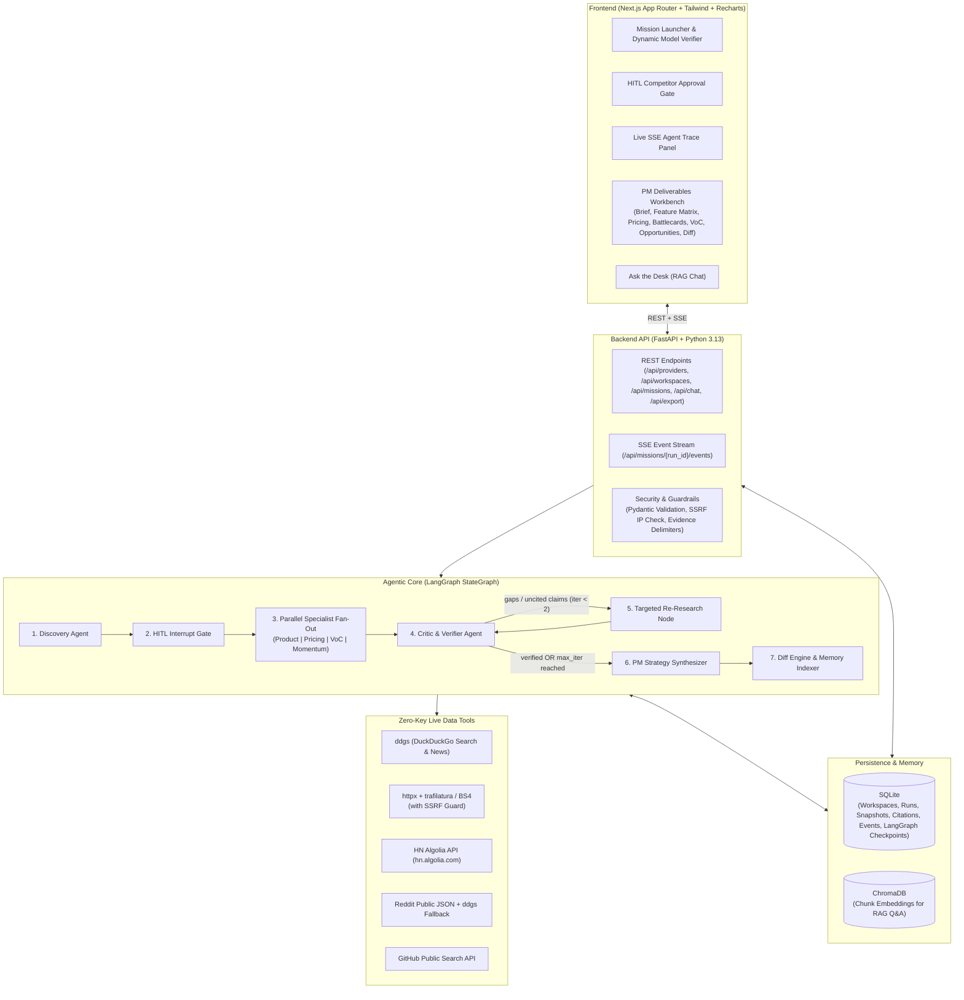

# Architecture: MoatRadar

## 1. High-Level System Architecture



---

## 2. LangGraph State & Execution Flow

### Graph State (`IntelligenceState`)
- `run_id: str`, `workspace_id: str`
- `product_name: str`, `product_description: str`, `target_segment: str`, `seed_competitors: list[str]`
- `llm_provider: SupportedProvider`, `llm_model: str`
- `discovered_competitors: list[CompetitorCandidate]`
- `approved_competitors: list[CompetitorCandidate]`
- `research_findings: Annotated[list[DomainFinding], operator.add]` (parallel fan-in reducer)
- `citations: Annotated[list[SourceCitationInput], operator.add]`
- `critic_report: CriticReport | None`
- `research_gaps: list[ResearchGap]`
- `iteration_count: int` (bounded: max 2 verification retries)
- `dossier: DossierPayload | None`
- `diff_summary: DiffSummary | None`

### Core Agentic Patterns
1. **Dynamic Multi-Provider LLM Abstraction (`app/llm/factory.py`)**: Instantiates LangChain chat models for `ollama` (`langchain-ollama`), `gemini` (`langchain-google-genai`), `openai` (`langchain-openai`), `anthropic` (`langchain-anthropic`), or `groq` (`langchain-groq`) without hardcoded default model lists. Cloud models are discovered dynamically via provider APIs when keys exist, and Ollama models are checked live via `POST /api/providers/ollama/check`.
2. **Human-in-the-Loop Checkpointing**: `discovery_node` populates `discovered_competitors` and hits `interrupt(...)` backed by `AsyncSqliteSaver`. The mission enters `awaiting_approval` until confirmed via `POST /api/missions/{run_id}/approve` (`Command(resume=...)`).
3. **Parallel Specialist Fan-Out**: For each approved competitor, collectors run concurrently under bounded async concurrency (`asyncio.Semaphore`).
4. **Critic / Reflection Loop**: `critic_verifier_node` validates factual claims against retrieved URLs/snippets, scores grounding and coverage, and loops back to `targeted_research_node` when gaps remain (`iteration_count < max_critic_iterations`).
5. **Longitudinal Snapshot Diffing & RAG**: `memory_indexer_node` computes structured diffs against the prior snapshot in SQLite and indexes evidence chunks in ChromaDB for citation-grounded Q&A.

---

## 3. Repository Layout

```text
moatradar/
├── .github/                  # CI workflow, Dependabot, Issue & PR templates
├── docs/                     # Architecture, PRD, and project roadmap
├── scripts/                  # Local development launcher
├── backend/
│   ├── Dockerfile
│   ├── pyproject.toml
│   ├── app/
│   │   ├── main.py           # FastAPI entrypoint, lifespan, CORS
│   │   ├── config.py         # Settings, live provider/model discovery, Ollama check
│   │   ├── db/               # SQLite repository + ChromaDB vector store
│   │   ├── schemas/          # Strict Pydantic v2 contracts
│   │   ├── llm/              # Multi-provider LangChain factory
│   │   ├── tools/            # SSRF guard, ddgs search, scraper, HN/Reddit/GitHub
│   │   ├── agents/           # LangGraph nodes, graph, diff engine, RAG chat
│   │   ├── services/         # Background SSE MissionRunner + Markdown/JSON exporter
│   │   └── api/              # REST + SSE API routes
│   ├── tests/                # Unit, security, integration, and graph tests
│   └── eval/                 # Grounding, completeness, and Critic evaluation harness
├── frontend/
│   ├── Dockerfile
│   ├── package.json
│   └── src/
│       ├── app/              # Next.js App Router workbench
│       ├── lib/              # Typed API client, SSE subscriber, URL sanitizer
│       └── components/       # UI workbench components & Recharts visualizations
├── docker-compose.yml
├── Makefile
├── LICENSE                   # Apache License 2.0
└── README.md
```

---

## 4. API Contracts

| Method | Path | Purpose |
|---|---|---|
| `GET` | `/api/health` | Health check + DB readiness |
| `GET` | `/api/providers` | Lists configured providers and live-discovered model identifiers (no secrets) |
| `POST` | `/api/providers/ollama/check` | Checks local Ollama reachability and whether the user-entered model is installed |
| `GET` | `/api/workspaces` | List saved workspaces & latest snapshot metadata |
| `POST` | `/api/workspaces` | Create a new workspace |
| `GET` | `/api/workspaces/{workspace_id}/snapshots` | List historical snapshots & diff summaries |
| `POST` | `/api/missions` | Start a new LangGraph mission run (`run_id`, `thread_id`) |
| `GET` | `/api/missions/{run_id}` | Fetch current run status, discovered competitors, events, and dossier |
| `GET` | `/api/missions/{run_id}/events` | SSE stream of live `AgentEvent` updates + HITL interrupt signal |
| `POST` | `/api/missions/{run_id}/approve` | Submit PM-edited competitor list & resume LangGraph from HITL |
| `POST` | `/api/missions/{run_id}/retry` | Recover failed/stalled runs with optional `skip_competitors` & BYOK headers |
| `GET` | `/api/workflow/spec` | Static workflow node contracts, prompt summaries, guardrails & AI concepts |
| `GET` / `POST` / `DELETE` | `/api/workspaces/{workspace_id}/documents` | Upload/list/remove workspace `.md`/`.txt`/`.pdf` custom evidence docs |
| `GET` / `PUT` | `/api/workspaces/{workspace_id}/monitor` | Configure recurring schedule (`off`/`daily`/`weekly`) & SSRF-checked webhook |
| `POST` | `/api/workspaces/{workspace_id}/chat` | Ask the Desk (RAG Q&A grounded in ChromaDB + SQLite citations) |
| `GET` | `/api/missions/{run_id}/export` | Export dossier (`format=markdown` or `format=json`) |

---

## 5. Security & Reliability Guardrails

- **SSRF Protection**: Every scraped URL is parsed and DNS-resolved before dispatch; private, loopback, link-local, multicast, and reserved IPs (`127.0.0.0/8`, `10.0.0.0/8`, `169.254.0.0/16`, `::1`, etc.) and non-`http(s)` schemes are blocked.
- **Prompt Injection Defense**: Untrusted web snippets are sanitized and wrapped inside `<untrusted_evidence>` delimiters; LLM outputs must satisfy strict Pydantic v2 schemas.
- **Bounded Execution & Search Resilience**: HTTP calls enforce `10s` timeouts, DuckDuckGo search bounds concurrency via per-loop semaphores with unquoted fallback on empty/rate-limited responses, and Critic verification retries are capped at `max_critic_iterations = 2`.
- **Credential Isolation**: `.env` API keys never leave the backend; `/api/providers` never returns secret material.
